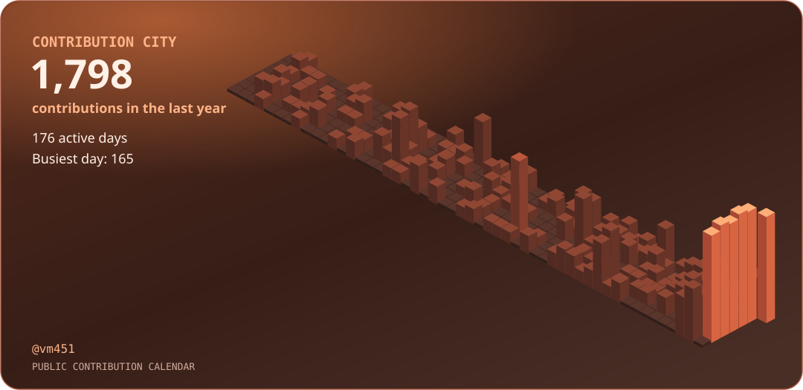
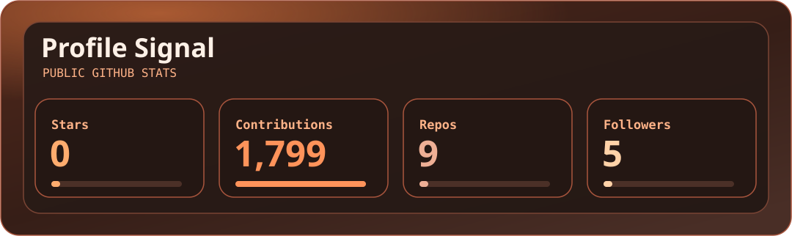

<!-- profile:begin -->

## The city I built this year

Every tile is a day; taller buildings mean more contributions.

2025-11-23 to 2026-11-26 · <a href="https://github.com/VM451#contributions">GitHub contribution calendar</a>

## Population

## Landmarks

[**SwiftBot**](https://github.com/VM451/SwiftBot) · [**ArchonKit**](https://github.com/VM451/ArchonKit) · [**TypstKit**](https://github.com/VM451/TypstKit) · [**SwiftPort**](https://github.com/VM451/SwiftPort)

## Visit

<a href="https://github.com/VM451">GitHub</a> · <a href="https://github.com/VM451?tab=repositories">Repositories</a>

<!-- profile:end -->

SVG cards generated from public GitHub data · <a href="https://github.com/VM451/vm451/actions/workflows/refresh-profile.yml">refresh workflow</a> checks every 15 minutes · Layout inspired by <a href="https://www.gitskins.com/templates/contribution-city">GitSkins</a>

