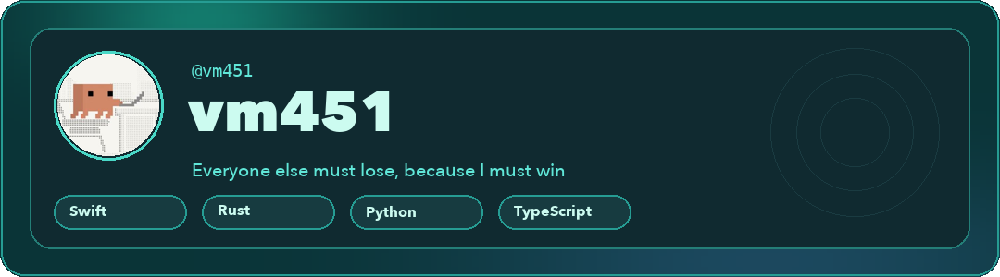
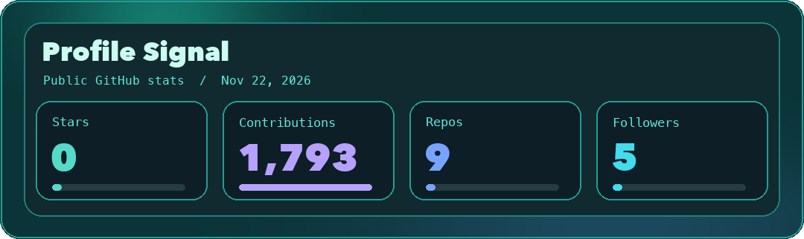
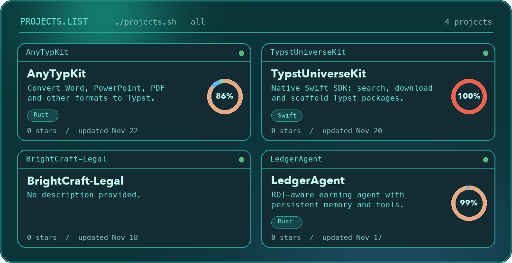

## The city I built this year

Every building is a day; taller means more contributions.

## Population

## Landmarks

[**AnyTypKit**](https://github.com/VM451/AnyTypKit) · [**TypstUniverseKit**](https://github.com/VM451/TypstUniverseKit) · [**BrightCraft-Legal**](https://github.com/VM451/BrightCraft-Legal) · [**LedgerAgent**](https://github.com/VM451/LedgerAgent)

## Visit

<a href="https://github.com/VM451">GitHub</a>

VM451 · GitHub data snapshot: Nov 22, 2026 · Layout inspired by <a href="https://www.gitskins.com/templates/contribution-city">GitSkins</a>

