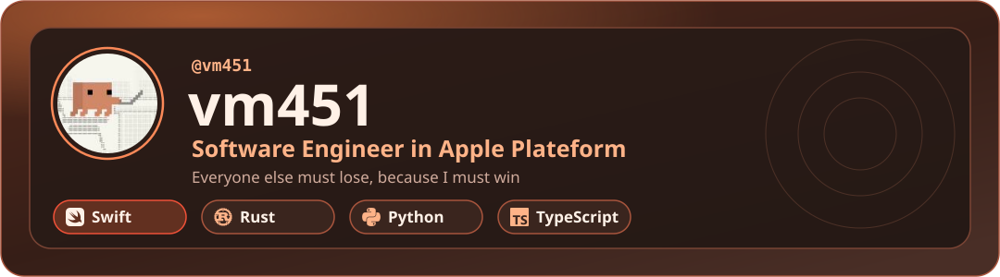
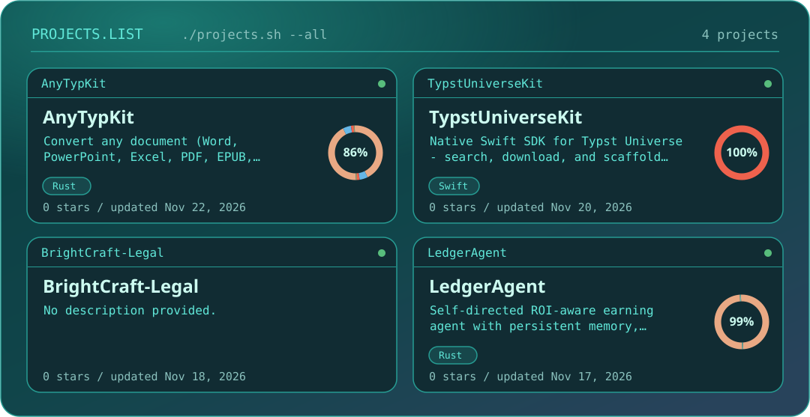

<!-- profile:begin -->

## The city I built this year

Every tile is a day; taller buildings mean more contributions.

2025-11-23 to 2026-11-22 · <a href="https://github.com/VM451#contributions">GitHub contribution calendar</a>

## Population

## Landmarks

[**AnyTypKit**](https://github.com/VM451/AnyTypKit) · [**TypstUniverseKit**](https://github.com/VM451/TypstUniverseKit) · [**BrightCraft-Legal**](https://github.com/VM451/BrightCraft-Legal) · [**LedgerAgent**](https://github.com/VM451/LedgerAgent)

## Visit

<a href="https://github.com/VM451">GitHub</a> · <a href="https://github.com/VM451?tab=repositories">Repositories</a>

<!-- profile:end -->

SVG cards generated from public GitHub data · <a href="https://github.com/VM451/vm451/actions/workflows/refresh-profile.yml">refresh workflow</a> checks every 15 minutes · Layout inspired by <a href="https://www.gitskins.com/templates/contribution-city">GitSkins</a>

